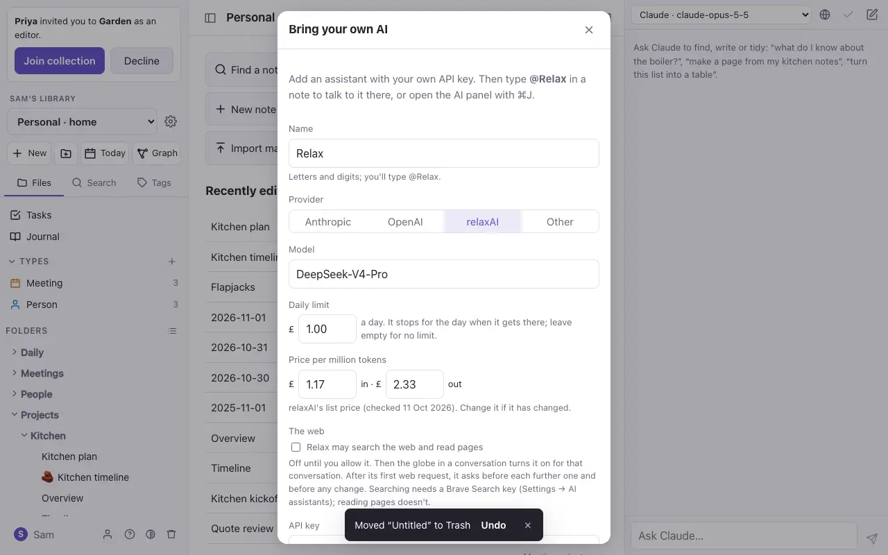
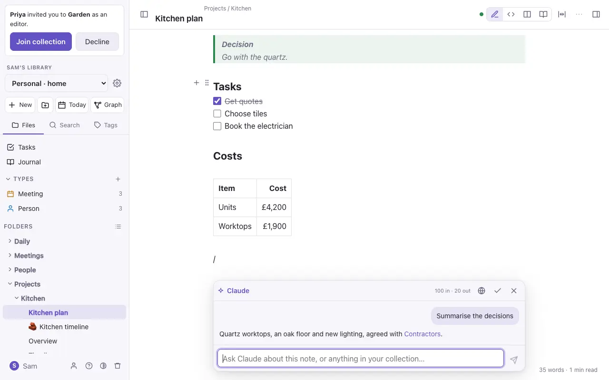
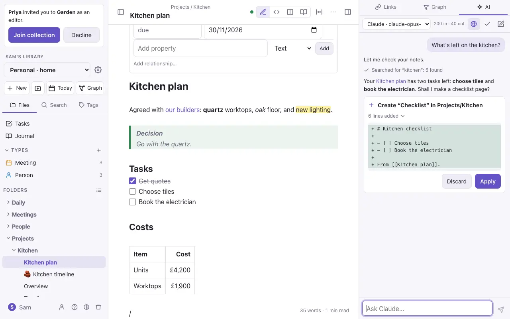

# AI assistants

DO Notes has no AI of its own. You add an assistant with your own key from an AI provider, and you pay that provider for what you use. Your key is stored encrypted, never shown again and never shared with other members.

## Adding an assistant

Settings → **AI assistants** → **Add an assistant** (or **Add an AI** in `⌘K`). Choose a provider (Anthropic, OpenAI, relaxAI or any OpenAI-compatible service), paste your key and pick a model.

Each assistant has a **daily limit** in pounds, £1 unless you change it. Every conversation shows what it cost, and when the day's limit is reached the assistant stops until tomorrow.

## Asking in a note

Type `@` and the assistant's name (such as `@Claude`) on a new line, then your question. The answer appears under the line. **✓** keeps it in the note as a folded callout; **✗** throws it away.

## The AI side panel

`⌘J` opens a conversation in the side panel that stays with you as you move between notes. The assistant can:

- **Find and answer**: search your notes and answer with links to them.
- **Write**: make new pages from what it finds.
- **Organise**: reformat a note, fill in properties, move notes, split a long note, or file notes into your [types](types.md).
- **Copy or move to another collection**: ask it to copy a note or a folder into another of your collections, or to move it there ("move this to my Work collection"). It always asks first; see *Another collection* in [Organising notes](organising.md) for what comes along.
- **Drive the app**: open a note, show the graph or hide a panel.

Changes to the open note happen straight away, and stay in its version history. Anything else, such as a new page or a change to another note, shows what it would change, with **Apply** and **Discard**, and Undo afterwards.

## The web

An assistant can also search the web and read pages, if you switch it on in two places:

1. **Allow it.** In Settings → **AI assistants**, press **Change** on the assistant and tick **may search the web and read pages**. This is off until you tick it.
2. **Turn it on for a conversation.** Press the globe at the top of the conversation. It lights up while the web is on. Each new conversation starts with it off. `⌘K` → **Let the AI use the web** does the same for the side panel.

Reading a page needs nothing more. To let the assistant **search**, add a Brave Search API key of your own under Settings → **AI assistants** → **Web search**. Its searches go to Brave under your key.

A web page, or a page clipped into your notes, could try to trick the assistant into sending your notes somewhere. So the assistant asks you before any search or page whose words you didn't type yourself, the first one included. The card shows exactly what would go out: **Allow** or **Don't**. A search you asked for in your own words ("search for boiler service intervals") or an address you pasted runs straight away, and so does opening a link that a search returned, because the address came from Brave, not from the assistant. Once it has read anything from the web, it also asks before any change, even to the open note.

## Connected services: Longview, Recall and others

Your assistants can read other places once you connect them in Settings → **Connections**. None needs the globe: once connected, they're there in every conversation.

- **Longview**, your knowledge base of AI news. Paste its address (filled in already) and one of its **read tokens** (`MCP_READ_TOKENS` in Longview's settings), then **Connect**. DO Notes checks them with one search, and refuses a token that could change Longview. Then ask, say, "what does Longview have on Gemini 4 Carbon?" or "what's new in Longview?": the assistant searches, looks up a model or company, follows a trend, or asks Longview's analyst, and cites what it found.
- **Floe**, your architecture landscapes. Paste Floe's MCP address and a **read-only** Floe token (`flt_…`), then **Connect**. Then ask "what's in my Payments landscape?" or "give me Floe's context diagram for Payments": the assistant lists your landscapes, opens one, and fetches a diagram as Mermaid C4 you can put in a note. To keep a whole landscape in a collection and up to date, see [Import](import-export.md).
- **Recall**, what you've saved to read. Press **Connect Recall…**, sign in on Recall's own page and allow DO Notes. That opens in a new tab, Safari's sheet in the iPhone app, or your browser from the Mac app. DO Notes asks Recall for **read access only**. Then ask "what did I save about tiling?": the assistant searches your cards and reads the ones that match.

The same care as the web: a search in your own words runs straight away, and anything else (a search built from your notes) asks first, showing exactly what goes out. Once the assistant has read from Longview or Recall, it asks before any change, since a saved page could try to steer it. The assistant can't change Longview or Recall, and they're offered only to the assistant inside DO Notes, never through Connect Claude. **Disconnect** removes the token (for Recall, it also tells Recall to forget the sign-in).

**Review** (beside each connected service) lists what the service offers, in three groups:

- **Read:** your assistants can use these. Turn off any you'd rather they didn't.
- **Doesn't say:** the service doesn't say whether these only read. They're off; turn one on only if you know it just reads, and the assistant then asks you before every use.
- **Changes things:** these would change something in the service. DO Notes only reads, so they can't be turned on.

**Any other service** that speaks MCP over the web can be connected too: **Add a connection…** under Connections. Paste its address (such as `https://example.com/mcp`) and press **Look**: DO Notes says what it found (*Items 2.1, an MCP service. It signs in with a token. It offers 4 tools: 2 read, …*), or why it can't be connected (a web page rather than a service, a sign-in on its own page, which only Recall can do for now, or tools that all change things). If it asks for a token, paste one (a read-only one, if it has them). If it doesn't ask who you are, DO Notes shows a warning first: anyone can use such a service, and your searches reach it unsigned, so only connect one you trust. Name it, **Connect**, and Review opens to choose its tools; **Try it** there makes one harmless call so you can see it answer. On the laptop kit, a service on the same computer can be connected at `http://host.docker.internal:<port>/mcp`.

**Send to Longview**, if you want it: under Longview in **Settings → Connections**, open **Send Weblink notes to Longview…** and paste one of Longview's **write tokens** (`MCP_WRITE_TOKENS`). Then a Weblink note's ⋯ menu has **Send to Longview…**: Longview saves the page at that address at once, with the reason you type, if any. Only the address goes, never the note. That token is kept apart from the read one and used for nothing else; the assistant still can't change Longview. **Turn off** forgets it.

**From your connections**, in the side panel: in a service's **Review**, tick **Look up the open note in the side panel**, and whenever you open a note the side panel shows what that service has on it (Longview's stories, your Recall cards, a search's results), as links that open outside DO Notes. It sends the note's **title**, never its text, so it's off until you turn it on for each service; it doesn't ask again each time. Results are kept for ten minutes per note.

If a service later changes what one of your chosen tools says it does, DO Notes stops using that service and says *changed a tool you chose*. Review shows what it said before and what it says now; saving lets your assistants use it again. That stops a service quietly swapping in a tool that behaves differently.

## Connecting Claude

Claude can search, read and write your notes as you, over MCP. Settings → **Connections** → **Connect Claude** shows how:

- **claude.ai and the Claude iPhone and desktop apps:** in claude.ai, open Settings → Connectors → **Add custom connector** and paste the address Connect Claude shows. Claude sends you to DO Notes, which asks **Let Claude use your notes?** Press **Allow**, or tick **Read only** first. Only allow an app you've just added yourself.
- **Claude Code and other agents** can sign in the same way, or use a personal token made on the same screen, which shows the command to run.

An agent has your roles: it can't see collections you can't, and it can't write where you're a viewer. Every connection is listed under Connect Claude, and **Disconnect** (or **Revoke**, for a token) ends it at once.
