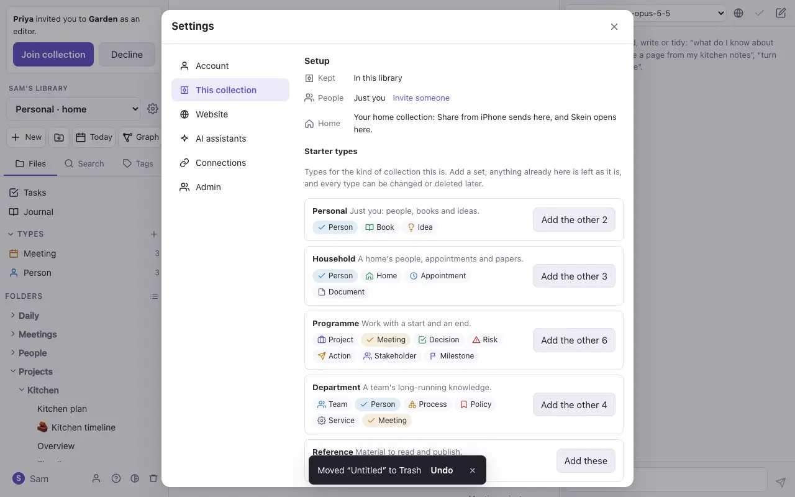

# Your library and collections

Everything on a Commonplace server is one **library**, such as *David's Library* or *Team Library*. A library holds **collections**: separate sets of notes, each with its own folders, types and members. You might have one for home, one for a programme at work and one shared with your team. Sharing one collection doesn't share the others.

The library's name is at the top of the file panel. Under it, the collection menu switches between collections and makes new ones. When your collections are kept in more than one way, the menu groups them into **In this library**, **In folders on this Mac**, **From GitHub** and **In the cloud**.

## Setup

Each collection has a **Setup**, at the top of Settings → **This collection**. A new collection opens there.

- **Kept:** where its notes live. That's this library's database, or this library with a copy from a GitHub repository (see [Import, export and GitHub](import-export.md)). On your Mac, it can also be a folder of Markdown files (see [Folders on your Mac](mac-folders.md)).
- **People:** just you, or how many people are in it. Owners can go straight to inviting someone. See [Sharing and live editing](sharing.md).
- **Home:** whether this is your home collection (below).
- **Starter types:** sets of [types](types.md) for the kind of collection this is. Each set adds only the types the collection hasn't got yet, along with any type their links need. Every type stays an ordinary note you can change or delete.

| Set | For | Types |
| --- | --- | --- |
| **Personal** | Just you | Person, Book, Idea |
| **Household** | A home's notes | Person, Home, Appointment, Document |
| **Programme** | Work with a start and an end | Project, Meeting, Decision, Risk, Action, Stakeholder, Milestone |
| **Department** | A team's long-running knowledge | Team, Person, Process, Policy, Service, Meeting |
| **Reference** | Material to read and publish | Article, Topic, Source |
| **Architecture** | Landscapes from Floe (see [Import](import-export.md)) | Landscape, Domain, Actor, System, App, Store, Component |

## Your home collection

One of your collections is your **home**. It's marked *· home* in the collection menu.

- **Share from iPhone** sends there when its token is set to *Home collection*, the default. If you change your home later, shares follow. See [On the iPhone](iphone.md).
- **Commonplace opens there** when it doesn't know which collection you were in last.

Your first collection, *Personal*, starts as your home. To change it, open another collection's Setup and press **Make this my home collection**. Each person has their own home, so making a shared collection your home doesn't change anyone else's.

## Your cloud library on your Mac

If you use Commonplace on your Mac (the laptop kit) and on the web, the Mac can show both in one menu. In Settings → **Connections** → **Cloud library**, give the web address and press **Sign in**: you sign in there and allow the Mac, and its collections join the menu under **In the cloud**.

- **Notes open and change as they do on the web**, live with everyone else in them. Notes you've opened stay on the Mac, so they open and take changes while the cloud can't be reached, and catch up when it's back.
- **Move to another collection…** moves notes, or a folder, between the Mac and the cloud, with their pictures, types and history. Undo puts them back.
- **Members, renaming, publishing and GitHub** are done in the cloud library itself.
- **Sign out** in the same place, or in the cloud's Settings → Connections → **Macs signed in**. Either way the Mac's access ends at once.

Your iPhone sees only the cloud library.

## The library's name

At first the library is named after the first admin, such as *David's Library*. An admin can rename it in Settings → **Admin** → **Library**, and an empty name goes back to the first admin's. Everyone on the server sees the same name.

> Other Markdown editors call a collection a *vault*. It's the same thing: a folder of Markdown files, which exports and imports as one.
