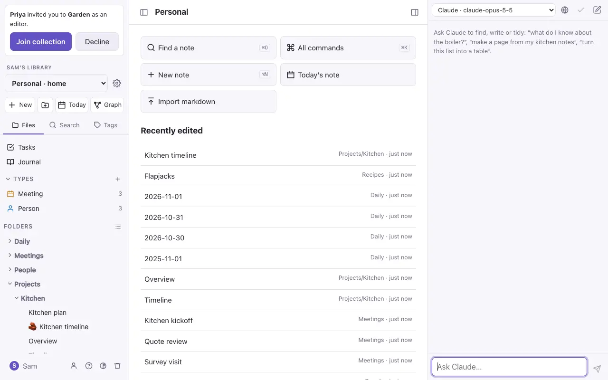
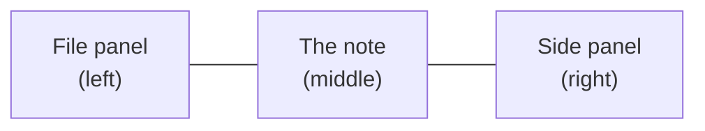
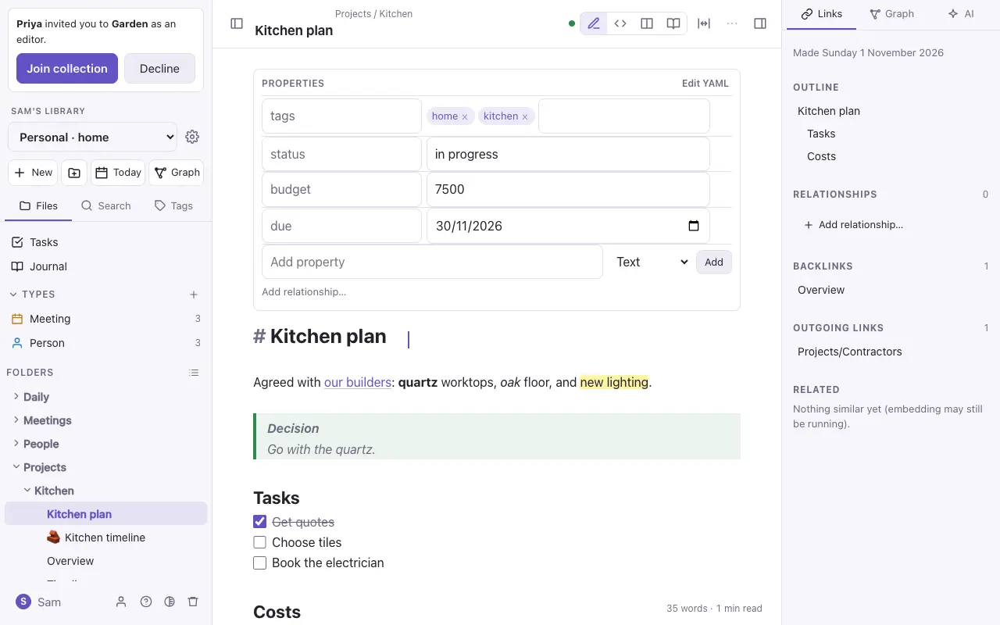

# Getting started

## Signing in

The first account made on a new server becomes the **admin**, and it gets a collection to start with. After that, an admin adds people in Settings → Admin. Or someone who already has a collection can invite you by email; see [Sharing and live editing](sharing.md).

### With a passkey: Face ID or Touch ID

Once you've signed in with your password, you can add a **passkey** and sign in with Face ID, Touch ID or your device's passcode from then on, with nothing to type. Go to **Settings → Account → Passkeys** and choose **Add a passkey on this device**; your device asks for your face or finger once. Next time, choose **Sign in with a passkey** on the sign-in page, or pick the passkey from the suggestions under the email box.

- iCloud Keychain shares a passkey between your Apple devices, so one added on the Mac works on the iPhone too. On other devices, add one there.
- It works in Safari and other browsers, the [iPhone app](iphone.md) and the [Mac app](mac-app.md). The Mac app's passkeys are for the cloud; for DO Notes on your Mac (the kit), use Safari, which has its own.
- Settings lists each passkey with when it was last used. **Remove** stops it signing anyone in (**Undo** puts it back). Your password keeps working either way.
- A passkey can't be guessed, phished or leaked from the server: the server holds only the half that checks it.

### Two-step sign-in: a code after your password

So that a password alone can't get in, you can ask for a code from a code app on your phone too (Apple Passwords, Google Authenticator, 1Password and others all work). Go to **Settings → Account → Two-step sign-in** and choose **Turn on two-step sign-in…**, scan the QR code with your code app (or, on the device with the app, choose **open it in your code app**), then type the code it shows and your password.

- From then on, after your password, DO Notes asks for the **6-digit code** your app shows. Signing in with a passkey doesn't ask: a passkey is two steps already.
- You get ten **recovery codes**, shown once: keep them in your password manager or print them. Each one signs you in once in place of the code if your phone is lost. **New recovery codes…** makes a fresh set (the old ones stop working); Settings says how many you have left.
- Turning it on signs out your other devices, so each signs in again with a code. **Turn off…** asks for your password.
- Locked out with no phone and no recovery codes? On the Mac's kit, `./commonplace.sh reset-password` gives you a new password and turns two-step off; in the cloud, ask whoever runs your DO Notes.

### Passkeys only

Once you have a passkey, you can drop your password altogether: **Settings → Account → Password → Sign in with passkeys only…**. There's then no password to guess, reuse or phish. Keep a passkey on more than one device (iCloud Keychain does this for your Apple devices). Your last passkey can't be removed while the account has no password. To have a password again, type a new one under **Password** and choose **Set a password**; your device confirms it's you with a passkey.

## Your library and its collections

Everything on a server is one **library**, such as *David's Library* or *Team Library*. Its name sits at the top of the file panel. At first it's named after the first admin, and an admin can rename it in Settings → Admin.

A library holds **collections**. A collection is a set of notes and the folders they're in. You might have one for home and one for work, and each has its own members, so sharing one collection doesn't share the others. Your first collection is called *Personal*. Pick a collection from the menu under the library's name, or make a new one there. [Your library and collections](collections.md) has more, including Setup and starter types. (Other Markdown editors call a collection a *vault*. It's the same thing: a folder of Markdown files.)

## The tour

The first time you open a collection, its home page offers **Take the tour**: a minute's walk round the screen, a step at a time, each step pointing at the part it describes. **Next** and **Back** move, Escape stops. Take it again from **Help** (the **?** at the bottom of the file panel), from `⌘K`, or by typing "tour" into Search or Find a note. **What's new**, beside it in Help, shows just what's been added lately; the home page offers it after each release. (What you've seen is kept on each device.)

Typing the name of something you can do, such as "tour" or "history", into Search or Find a note offers that command as well as the notes it finds.

## The screen

- **The file panel** (left): the collection menu, buttons for a new note, a new folder, today's note and the graph, and three tabs: **Files**, **Search** and **Tags**. Under Files are **Tasks**, your **types** and your **folders**. Your name at the bottom opens Settings, and the bin opens Trash. `⌘\` shows or hides it.
- **The note** (middle): its folder and title at the top, the view buttons (Live Preview, Source, side by side and Reading), the **⋯** menu for this note, and the text.
- **The side panel** (right): the **Links** tab (outline, backlinks, outgoing links, mentions and related notes) and the **AI** tab. The button at the top right shows or hides it.

**Light or dark:** the sun, moon or half-circle button at the bottom of the file panel, beside Trash, steps through **Light**, **Dark** and **Auto**. Auto follows your device's own setting. The same choice is in Settings → Account and in ⌘K ("Theme"). Each device remembers its own.

To make either panel wider (handy for the graph in the side panel), drag its inner edge. Double-click the edge to put it back. With the keyboard, Tab to the edge and use the arrow keys. Each browser remembers the widths. On a phone the panels are drawers, so there's nothing to drag.

On a phone the two panels slide in from the sides; see [On the iPhone](iphone.md).

## Your first note

1. Press **New** (or `⌥N`). A note called *Untitled* opens.
2. Click the title to rename it.
3. Type. Notes save as you go: there's no Save button.
4. Type `[[` to link to another note, `#` to add a tag, or `/` at the start of a line for headings, lists, tables and more.

Next: [Writing notes](writing.md).

> [!tip] Everything is in ⌘K
> `⌘K` opens a list of every command: what you can do with this note, what you can make, and where you can go. Type a few letters to find one. On a phone, the **⋯** menu has the note's commands.
