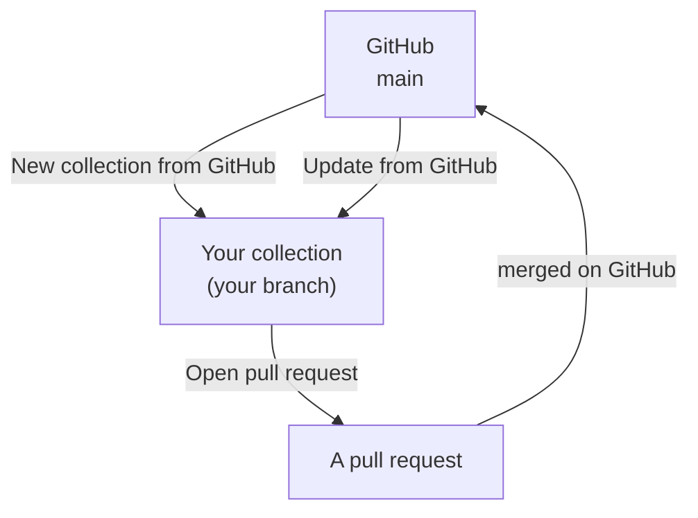
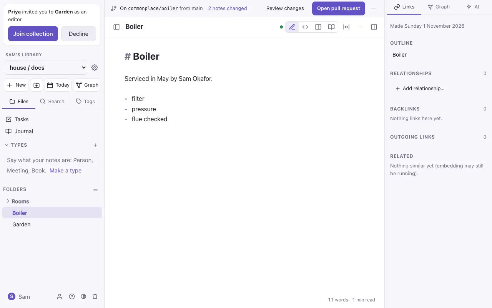
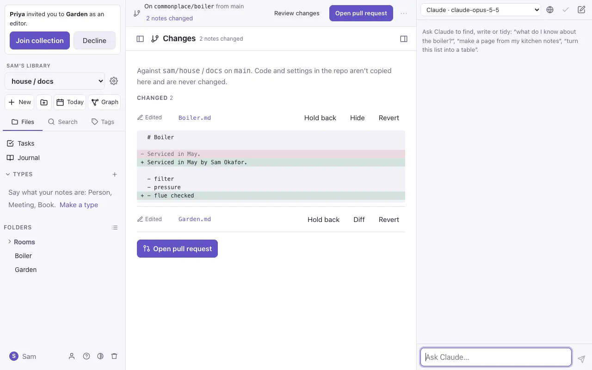
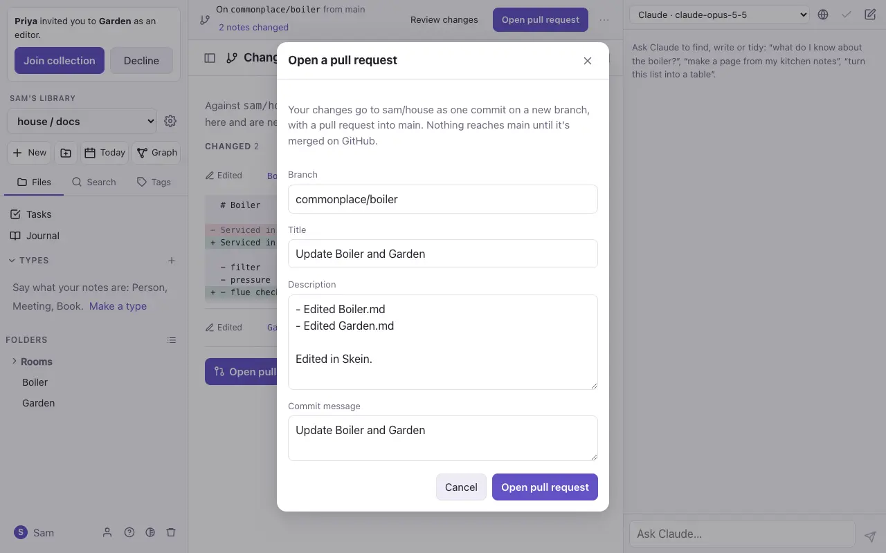
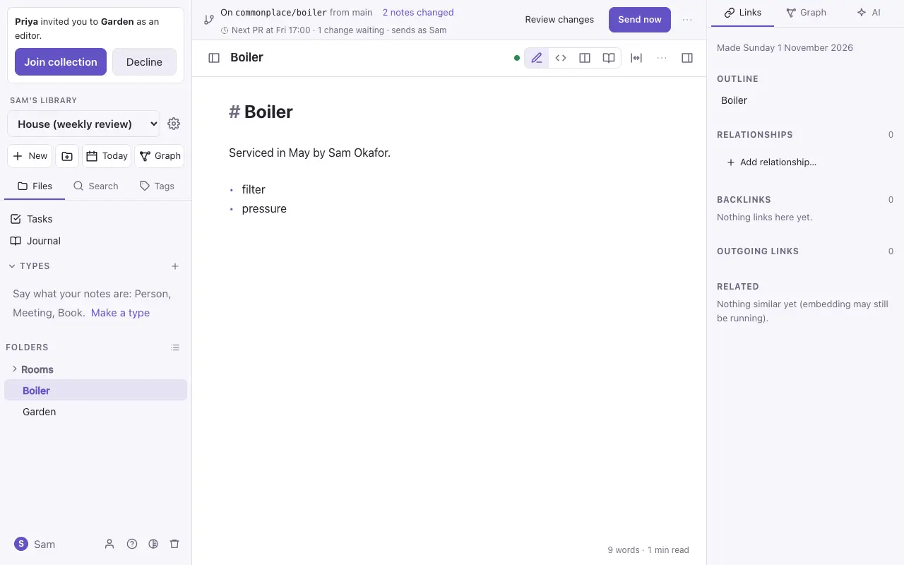
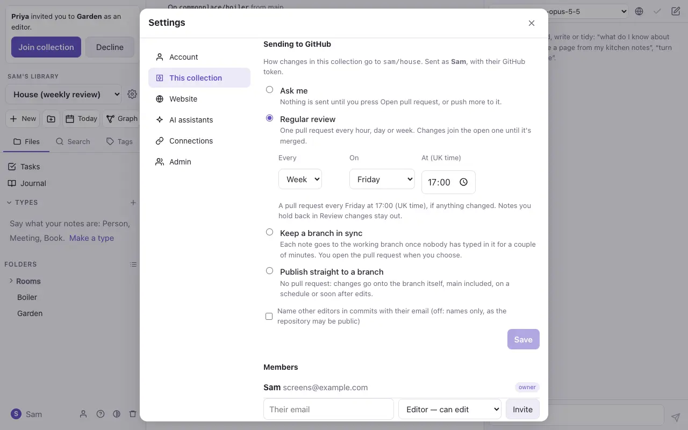

# Import, export and GitHub

## Import

Settings → **This collection** → **Import markdown**. Pick a `.zip` of a collection, a folder, or some `.md` files. Folders, pictures and links come in as they are, and `.canvas` files become [boards](boards.md). App-settings folders (names starting with `.`) are skipped.

If a note already exists you choose what happens: **skip** it, **overwrite** it (the old version stays in its history), or **keep both**.

### Architecture from Floe

With Floe, the architecture modelling tool, connected (Settings → **Connections**), you can bring a landscape in and keep it up to date, writing beside it as you go.

- **Bring it in:** `⌘K` → **Bring in a landscape from Floe…**, and choose the landscape. DO Notes says what will come (so many notes, and the types they need) and offers a folder, `Architecture/<landscape>`; change it if you like, then **Bring in**. Each system, app, store and component becomes a note, with `[[links]]` for what it uses and contains, and the landscape's overview note holds its diagrams.
- **Write in them:** each note shows a quiet **From Floe** label above the part that's Floe's: its description and its *Contains*, *Uses* and *Used by* lists. Everything else is yours: write below it, add headings and properties of your own.
- **Update from Floe:** in a landscape note's **⋯** menu (or `⌘K`). DO Notes shows what will change first: notes changed, new, renamed or removed in Floe, and whose writing is kept. **Update** changes only Floe's part of each note. An object renamed in Floe renames its note, and links to it follow. One removed in Floe is kept here, marked `status: removed`, never deleted. If you had changed Floe's part of a note, the preview says so, and Floe's version replaces it: keep your thoughts outside it.
- **When Floe changes:** opening the landscape's overview note asks Floe, once a session, whether anything has changed, and if so offers **Update**.
- **Open in Floe** in the **⋯** menu opens the landscape in Floe.

The notes say what they are (`type: system`, `type: app` and so on), so the **Architecture** starter types come too, with forms, tables and colours for Floe's properties: technologies, owner, status, and security facts such as classification. Each note keeps its `floe-id`, and `part-of` shows what it sits inside, so the graph draws the landscape. Nothing in Floe changes: DO Notes only reads it.

**From a file:** Floe can also export a landscape as a folder of notes (**⋯ → Export as folder of notes**), which imports as above, adding the starter types its notes name. This works for any import: a note that says `type: person` brings in the Person type, if there isn't one. Types the collection already has are left as they are. If you later bring the same landscape in from Floe into that folder, those notes are taken over: Floe's text goes on top, and what was in them stays below.

**Diagrams in a note.** In any note, `/` → **Floe diagram…** lets you choose a landscape and a diagram, and puts it in as a Mermaid block whose first line names it:

````markdown
```mermaid
%% floe: Payments / Context · 3f2a…
C4Context
  …
```
````

**Update Floe diagrams** in the note's **⋯** menu redraws each one as Floe has it now. You can also type a block yourself with just the names (`%% floe: Payments / Context`): updating fills it in and adds the diagram's id, so renaming it in Floe later doesn't break the link. To refresh many notes at once from a terminal, run `bun scripts/floe-diagrams.ts` in the app's source folder (`--list` prints every diagram's line, ready to paste).

## Export

- **One note**: **Download .md** in the note's ⋯ menu.
- **The whole collection**: **Export collection as .zip** in `⌘K`, or in Settings → This collection. The zip is a plain folder of Markdown files and attachments that other Markdown editors open as they are.
- **As an AI-XF bundle**, for Longview and other AI-XF tools: see below.

## AI-XF bundles

[AI-XF](https://github.com/DavidROliverBA/ai-xf-format) is a way of passing a set of Markdown notes between tools, such as Longview, with what they are and how they connect kept intact. Commonplace sends and takes bundles as they are, with nothing to convert.

**Export one:** Settings → **This collection** → **Export as AI-XF bundle (.zip)**, or `⌘K` → **Export collection as AI-XF bundle**, or **Export as AI-XF bundle** in a folder's menu for just that folder. In the zip:

- **Every note has an id** that never changes (see [ids](types.md)). Notes without one (older notes, or ones that came in from elsewhere) are given one first; you're told how many and asked once.
- **Relations become typed links.** `attendees: ["[[Sam Okafor]]"]` goes out as `links: [{rel: attendees, to: sam-okafor}]`, with a link to Sam's note under **Related** at the end of the note, as AI-XF asks.
- **A manifest and two vocabularies** say what the bundle is, and what its types and kinds of link mean. The collection keeps its manifest (`manifest.ai-xf.yaml`), so the bundle's name for itself (its namespace) stays the same each time.
- Properties AI-XF uses for something else go under `commonplace:` (a project's `status: Active`), and come back when it's imported.

Your notes aren't changed by an export, apart from the ids. The bundle passes the AI-XF validator at its strictest level.

**Import one:** import the `.zip` as above. Commonplace sees its manifest, and:

- every property comes in as it was, including `verified`, `provenance` and a tool's own;
- typed links become relation properties again, linking to the notes in the bundle (a link to another bundle's note, `namespace/id`, waits until that bundle is imported too);
- types the bundle uses that the collection hasn't got are made, so their pages work.

## Backups

The server can make a backup of every collection each day; an admin sets this up. See the project's README for how.

## GitHub collections

A GitHub collection is a repository of Markdown (or one folder of it, such as `docs/`) opened as a collection, using your own GitHub token.



1. Settings → **Connections** → **GitHub**: add a fine-grained token for the repository.
2. **New collection from GitHub…** in `⌘K`: pick the repository, branch and folder.
3. Edit as usual. A bar at the top says which branch you're on and how many notes have changed.
   On an iPhone the bar is at the top of the Files panel, so the note keeps the whole screen; a
   dot on the Files button means there are changes not on GitHub yet (orange: something to settle,
   or sending is paused).



- **Review changes** lists each changed note with its differences from GitHub, and a **Revert** for each.
- **Open pull request** sends your changes to GitHub as a pull request. Later edits are added to it with **Push changes to the pull request**.
- **Update from GitHub** brings in newer work. Notes changed on both sides are merged line by line, and a real clash waits for you to pick a side.
- **Cancel the branch** puts every note back as it is on GitHub.

Unless an owner chooses to publish straight to it (below), nothing reaches `main` without a pull request. Files that aren't notes or pictures (code, settings) are never touched.





### Sending changes on their own

An owner chooses how a GitHub collection's changes go to GitHub, in Settings → **This collection** → **Sending to GitHub** (or `⌘K` → **How changes go to GitHub…**):

- **Ask me** (the default): nothing is sent until you press **Open pull request**.
- **Regular review:** one pull request every hour, day or week, at a time you choose (UK time). If nothing changed, nothing is sent. Changes join the open pull request until it's merged; after that, the next one opens a new pull request.
- **Keep a branch in sync:** each note goes to the working branch once nobody has typed in it for a couple of minutes. You open the pull request when you choose.
- **Publish straight to a branch:** no pull request. Changes go onto the branch itself (`main`, or another you name), on a schedule or soon after edits. A push to `main` often builds or deploys a site, so the schedule is the safer choice. Deleted notes wait until someone presses **Send now**.

Changes are sent with the GitHub token of the owner who chose, and the bar says so.



- **Send now** sends straight away, in any of these ways.
- **Hold back** a note in Review changes to keep it out until you **Release** it.
- **Pause automatic pushes** is in the bar's `⋯` menu. Use it for a big reorganisation.
- Before every send, newer work on GitHub is merged in first. If a note clashes, sending pauses until you pick a side in Review changes, then carries on by itself.
- If the sender disconnects GitHub or stops being an editor, or GitHub refuses a push (for example, a protected branch), sending pauses and the bar says why.
- Commits name the other people who edited the notes. Their emails are left out unless the owner turns that on, since the repository may be public.


