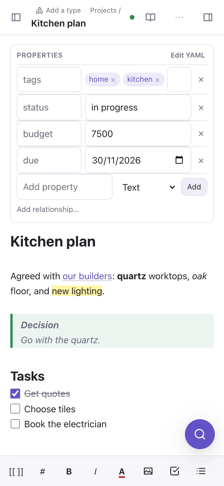
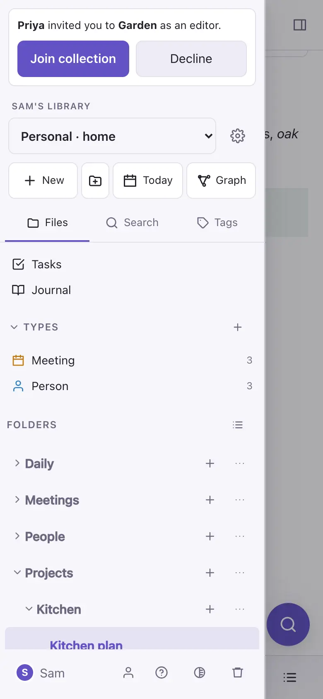
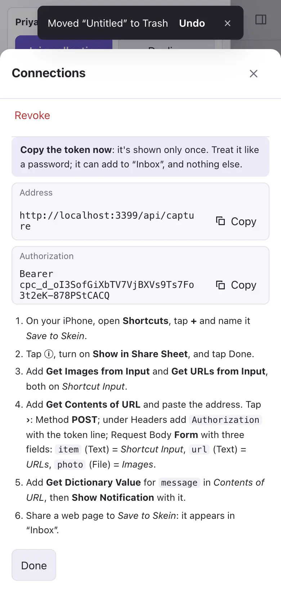

# On the iPhone

## The DO Notes app

The **DO Notes** app shows the same DO Notes as the web, full screen, and adds **DO Notes** to every app's share sheet. Install it from the TestFlight invitation, open it and sign in as you do on the web: that's all. Links to your DO Notes open in the app, and links to other sites open in a Safari sheet over it. Exports and downloads offer the share sheet, so you can save them to Files or send them on. The app leaves out the bar Safari puts above the keyboard (the arrows and the tick), so your note has that row; to put the keyboard away, swipe down over the text.

## Or add it to the home screen

Without the app, open DO Notes in Safari, then **Share** → **Add to Home Screen**. It opens full screen, like an app.

If you stay in Safari instead, its address bar sits above the keyboard in the Compact and Bottom layouts. **Settings → Apps → Safari → Tabs → Top** moves it out of the way. The small ˄ ˅ ✓ bar above the keyboard is the iPhone's own: no web page can hide it, so DO Notes keeps the box you're typing in clear of it. In the file panel, **Search** folds away the collection and buttons above it while you type, so the box is at the top and the results have the screen; clear the words to bring them back. On a GitHub collection the panel's bar is one compact line; tap **notes changed** for the branch and the changes.

## The phone layout

The note fills the screen. The file panel slides in from the left (the button at the top left) and the side panel from the right. Above the keyboard, a bar has formatting buttons, the `/` menu and the picture button, which picks from Photos or takes a photo.

Press and hold a note or folder in the file panel to drag it. The view switch at the top of a note goes between editing and reading.

### More room for the note

- Scroll down and the bar at the top tucks away; scroll up a little, or back to the top, and it returns.
- The round find button steps aside while the bar is away and while you type, and comes back when you pause.
- **Focus mode**, in a note's **⋯** menu, hides the top bar and the formatting bar too. Tap **Leave focus** at the top right to come back.
- On a GitHub collection, the branch bar is at the top of the file panel; see [Import, export and GitHub](import-export.md).

## Offline

Every note you've opened is kept on the phone. With no signal, the app still opens, you can read and edit those notes, and your changes merge with everyone else's when you're back online. Signing out removes them from the phone.

## Share from other apps

**With the app:** tap **Share** in any app (Safari, Photos, Notes…) and choose **DO Notes**. It shows what it's about to save; tap **Save**. A link, some text or up to 10 photos go to the Inbox in your [home collection](collections.md) as to-dos to file later. The app sets this up when you sign in, with a token called **iPhone app** and a short code of its own (such as *iPhone app · 7Q4K*) in Settings → **Connections** → **Share from iPhone**. Revoke it there and sharing stops until you next open the app, which makes a new one; sign out in the app and it stops at once. Each iPhone keeps one token: when it makes a new one, it revokes its old ones.

**Without the app:** Settings → **Connections** → **Share from iPhone** sets up an Apple Shortcut, so **Save to DO Notes** appears in every app's share sheet. Links, text and photos you share land as to-dos in an inbox note, in your [home collection](collections.md) unless you pick another. A shared web link can also become a **Weblink** note, with the page's title, summary and picture.

## The widget

Add the **Save to DO Notes** widget to your home screen or lock screen (press and hold an empty spot, tap **Edit** → **Add Widget**, and choose DO Notes). Tap it and DO Notes opens with a small form: type a few words and tap **Save**, and they go to the Inbox as a to-do. Or tap **Record** for a voice note: speak, tap **Stop**, and DO Notes writes down what you said on the phone itself; **Save** puts the recording in the Inbox with your words under it, so you can read it without playing it, and search finds it.

## Save with Siri

With the app, say **"Hey Siri, save to DO Notes"** (or *add to DO Notes*, *note in DO Notes*). Siri asks what to save, and puts what you say in the Inbox in your [home collection](collections.md), as a to-do to file later. It uses the same sign-in as sharing, so open the app and sign in once first. **Save to DO Notes** is also in the Shortcuts app, Spotlight and the Action button's settings, where you can type it instead.

**"Open a note in DO Notes"** (or *find a note in DO Notes*): Siri asks which note; say its title, and DO Notes opens at it, from any of your collections (the same title first, then one starting with your words, then one containing them). **"Ask DO Notes"**: Siri asks for your question, and DO Notes opens with it sent to your assistant in the side panel, which answers from your notes as it does when you type. Both open the app rather than answer in Siri, so they use the app's sign-in and nothing else. In Shortcuts they're **Open a Note** and **Ask DO Notes**.
