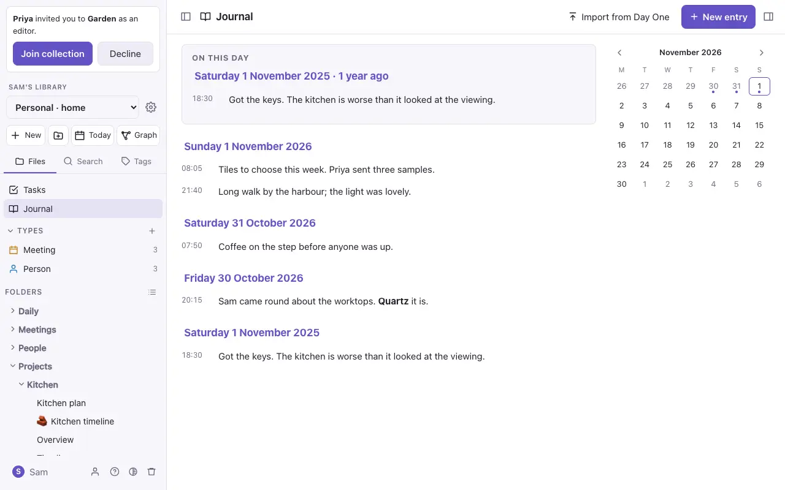

# The journal

The journal is entries in your daily notes: a few lines about your day, each stamped with the time. They're ordinary Markdown in the day's note, under a `## Journal` heading, so they export, go to GitHub and open in other editors as written.

## Writing an entry

Any of these opens **New journal entry**:

- `⌘K`, then *New journal entry*;
- a note's **⋯** menu;
- on the iPhone, **press and hold Today** in the file panel (on a laptop, right-click it).

Write the entry and press **Add entry** (or `⌘Enter`). It goes into today's daily note in your [home collection](collections.md), making the note if there isn't one yet, from your daily template if you have one. A toast offers to open it.

In the note it reads like this:

```markdown
## Journal

### 08:12

Coffee in the garden before anyone was up.

### 21:40

Long walk by the harbour.
```

You can also write entries straight into a daily note: anything under `## Journal`, as `### HH:MM` and some text, is a journal entry.

The [AI assistant](ai.md) can add one too ("journal that the boiler was fixed today"). Like any change outside the open note, it shows you the entry first.

## The journal page



**Journal**, under Tasks at the top of the file panel (or `⌘K` → *Journal*), shows the journal entries in the collection you're in, newest day first. Press a day's title to open its daily note.

- **On this day** at the top shows entries from the same date in earlier years.
- **The calendar** opens any day's note.
- **Earlier days** at the bottom loads older entries.

## Reflect on this week

`⌘K` → **Reflect on this week** opens your [AI assistant](ai.md) in the side panel with the last seven days of your journal (from your home collection) and a request: sum up the week, name what keeps coming up, what went well and what weighed on you, and ask you a question or two. It doesn't change any notes. Save the conversation as a note if you want to keep it.

## Import from Day One

1. In Day One, choose **File → Export → JSON** (on the iPhone: Settings → Import/Export → Export JSON) and save the zip.
2. In DO Notes, open the journal page of the collection it should go into and press **Import from Day One** (or `⌘K` → *Import from Day One*). Choose the zip.
3. DO Notes says how many entries it found and on how many days, then imports them when you press **Import**.

Each entry goes into its day's daily note under `## Journal`, at the time it was written where you were. Day One's titles become bold, its tags follow the entry as `#tags`, and its photos and files are stored under `attachments/Day One` and shown where they were. Location, weather and stars aren't kept. Empty entries are skipped, and importing the same export again adds nothing.

> Your journal stays private: a [published website](website.md) always leaves out `## Journal` sections, even when it publishes your daily notes.
