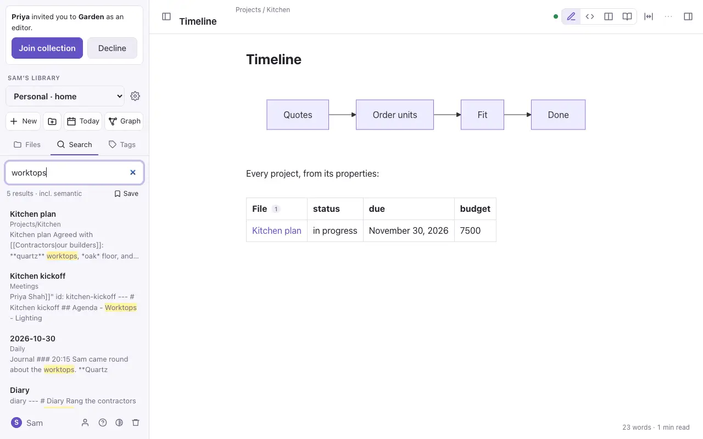
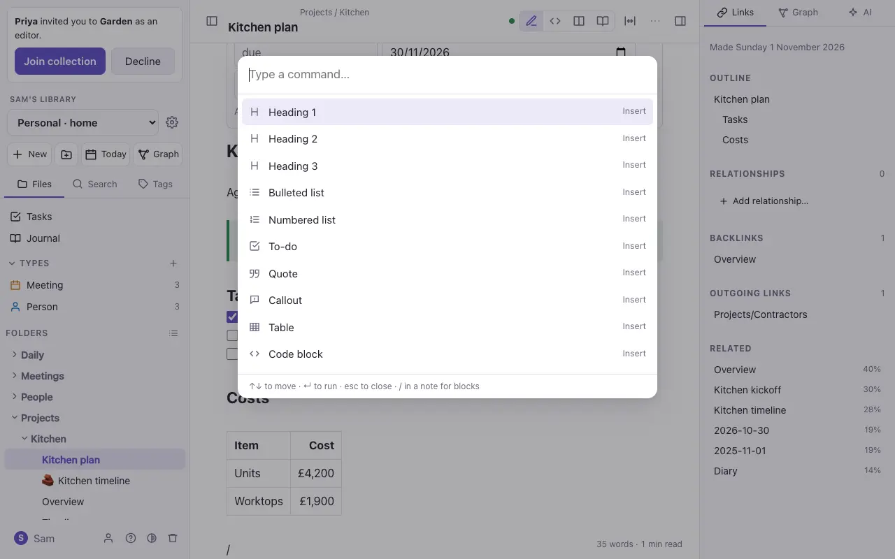

# Finding things

## Search

The **Search** tab (or `⌘⇧F`) searches the words in every note and finds notes by meaning as well, so "worktops" can find a note that says "counters". Results matched by meaning are marked.

- `tag:garden` finds notes with that tag.
- `path:Projects` finds notes in that folder.
- **Save** keeps a search in the file panel, to run again in one click.

### The words inside files

Search also finds the words **inside files**, and shows the note that uses the file, with *In Boiler certificate.pdf:* and the words around the match:

- **PDFs:** their text is read when they're added (a scanned PDF with no text in it can't be).
- **Photos** shared or saved from the DO Notes app on the iPhone or Mac: the app reads any words in them (a receipt, a sign, a page) as it sends them, on the device itself.
- **Voice notes** recorded in the app: what you said, written down on the device.

The words are kept with the file, not written into your notes. Photos added in the browser aren't read.

## The quick switcher

`⌘O` opens a box to find a note by name. Type part of its name and press Enter. If there's no note with that name, Enter makes one.

## Every command

`⌘K` (or `⌘P`) lists every command that applies right now: inserting blocks, what you can do with this note, making things, going places, and opening each part of Settings. Type to filter it.

> [!note] In the standalone file
> Search finds words and `#tags` in the open folder, and `⌘O` opens a note by name. There's no search by meaning, saved searches or command list.
