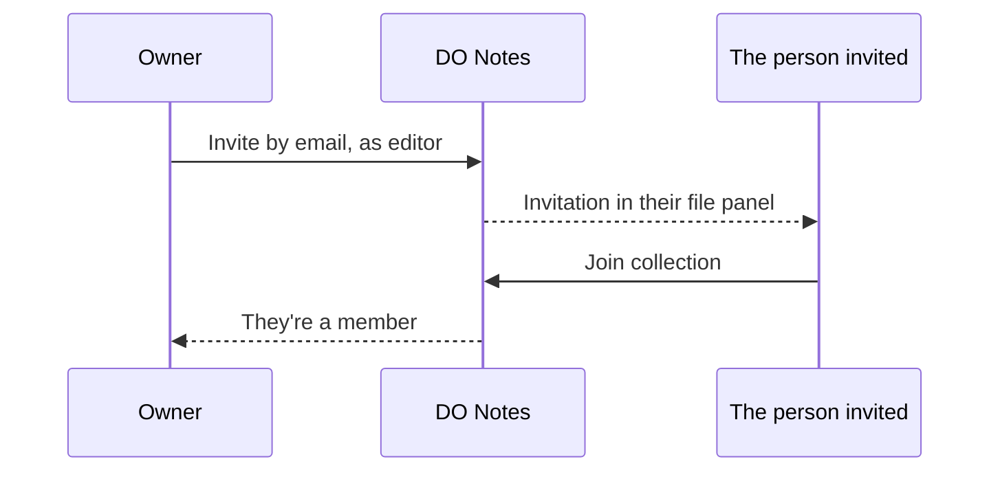

# Sharing and live editing

## Members and roles

Each collection has its own members, and each member has a role:

| Role | Can |
| --- | --- |
| **Owner** | Everything an editor can, plus invite and remove people, change roles, publish the collection as a website, rename it and delete it. |
| **Editor** | Read, write, make, move and delete notes and folders. |
| **Viewer** | Read only, everywhere. |

## Inviting someone

1. Settings → **This collection** → **Members**.
2. Enter their email and pick a role.
3. They see the invitation at the top of their file panel, with **Join collection** and **Decline**. If they don't have an account yet, it waits for them.

Nobody can see the collection until they accept. An owner can cancel an invitation, or remove a member (with Undo), and anyone can leave a collection they've joined with **Leave collection**.

## Editing together

Several people can be in one note at once. You see each other's cursors and selections, with names, and the people in the note at the top. Changes merge letter by letter, so nobody's typing is lost, and **Undo** undoes only your own changes.

If you lose your connection, keep typing: the note merges with everyone else's changes when you're back online.

## Comments

Select some words in a note, then **⋯** → **Comment…** (or ⌘K → Comment), and write your comment; `@Name` tells someone. The words are marked in the note, and the comment appears under **Comments** in the side panel, where anyone who can edit can **Reply** or **Resolve** it (with Undo). A comment stays on its words while people edit around them. Resolved comments fold away under *N resolved*, with **Reopen**.

Comments are kept beside the note, never in its Markdown, so the note's text stays as you wrote it. Viewers can read them. An export of the collection includes them in a `.comments` folder, one file per note, and backups keep them.

## Notifications

The **bell** at the bottom of the file panel shows how many things are new for you, and lists them, newest first; choosing one opens its note.

- **Mentions:** someone writes `@` and your name (or links `[[Your Name]]`) in a note you can see. Typing `@` in a note lists the collection's people as well as your AI assistants; choosing a person writes `@Name`, and they're told.
- **Invitations:** you're invited to a collection, or someone accepts your invitation.
- **Notes you follow:** **⋯** → **Follow this note**, and you're told when someone else changes it (at most once an hour). **Stop following** is in the same place.
- **Comments:** someone comments on a note you wrote, or replies to your comment.

You're never told about what you did yourself. **Since you last looked here**, under the list, shows the notes others made or changed in the open collection; **Mark this collection seen** starts it again from now.

The DO Notes app on your iPhone and Mac shows these as alerts too, whenever it refreshes (when you open it, and on the iPhone now and then in the background), so one can arrive a little after it happened.

## Share one note by link

To let someone read one note without inviting them or publishing a website: open the note, **⋯** → **Share by link…**, and **Make a link**. The link is copied; anyone who has it can read the note, without signing in, but nobody can edit it. It isn't listed anywhere, and search engines are asked to leave it out.

- It's the note **as it is now**: later edits stay private until you choose **Share by link…** → **Update the page**.
- **Links to your other notes** show as plain words, since nothing else is shared; pictures and files the note shows come with it.
- Hidden comments (`%%…%%`) stay hidden, as on a website.
- **Stop sharing** (in the same place) takes the page away at once; **Undo** puts it back at the same link.

Anyone who can edit the note can share it; viewers can open the link once it exists.

