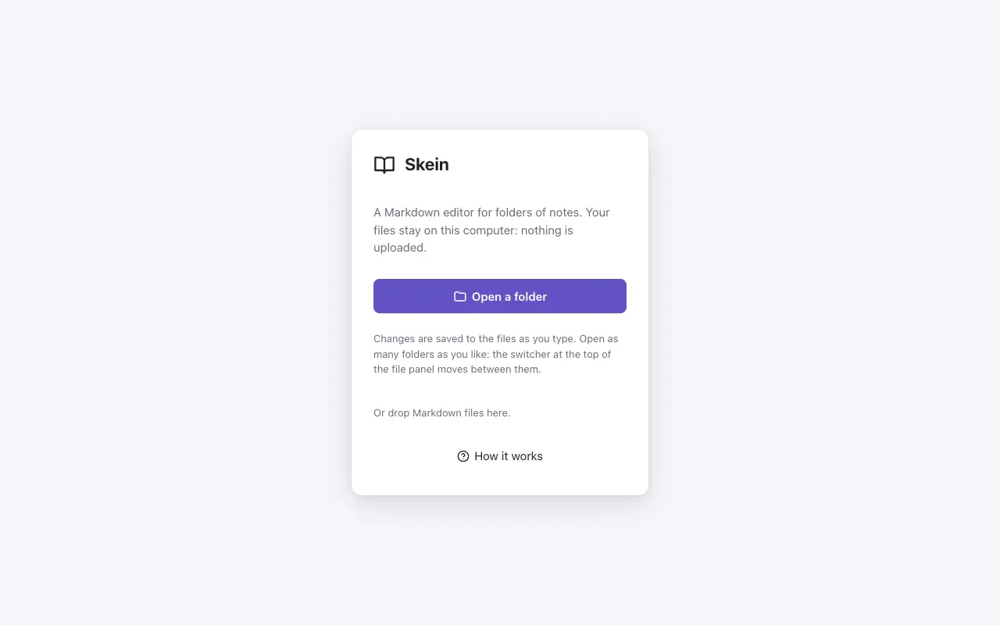
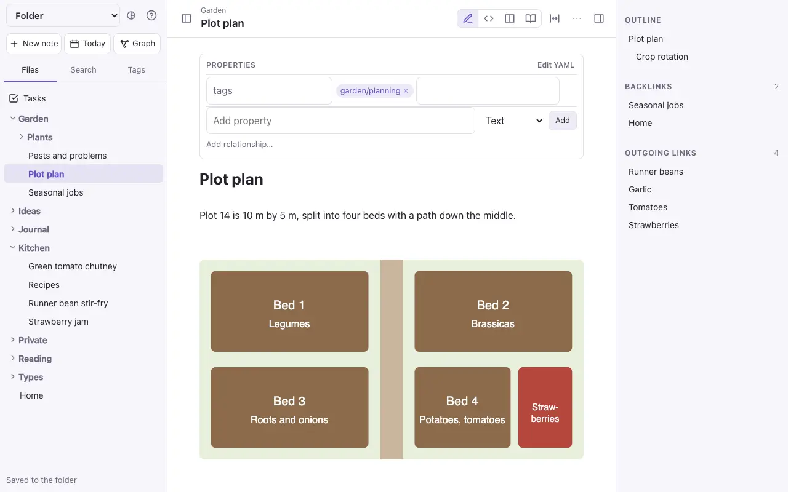
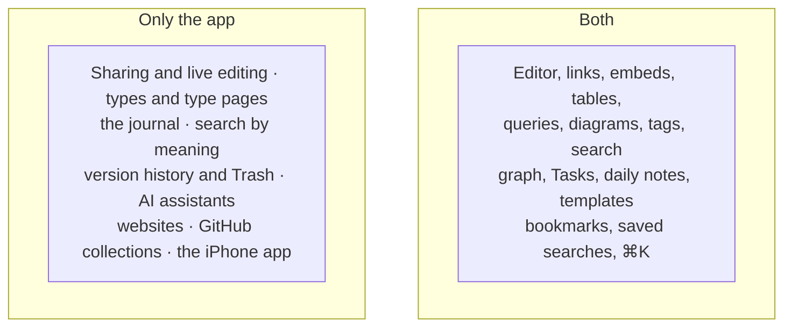

# The standalone file

`commonplace.html` is the DO Notes editor in one file. Open it in a browser, choose a folder of Markdown files, and edit. You can open several folders at once. There's no account, no server and no upload: your notes stay on your computer.

Download it from the project's releases on GitHub.

## Which browser

| Browser | How it saves |
| --- | --- |
| **Chrome** and **Edge** | They open the real folder and save each change to its file half a second after you stop typing. The start screen lists the folders you've opened before, to **Reopen** in one click (× takes one off the list; its files are left alone). |
| **Safari** and **Firefox** | They can't write to a folder, so the folder (or some files) is read into the tab. **Download changes** saves the changed notes as a zip to unzip over the folder. Closing the tab with changes not downloaded asks first. |

## Several folders at once

Each folder you open is a collection. The menu at the top of the file panel lists the open ones: choose one to move to it, **Open another folder…** to add one, or **Close** to put one away (in Safari and Firefox, closing a folder with changes not downloaded asks first). Each folder keeps its own place, bookmarks and saved searches, and a link always finds its note in the folder it's written in.

## What it has

- The same editor as the app: Live Preview, Source, side by side and Reading; the `/` menu for blocks, the formatting bar over selected words, folding headings, a preview of a linked note when you rest the pointer on it, dragging blocks by their handle, the properties panel, an emoji icon and a cover picture; links and `[[` completion, embeds, callouts, [tables](writing.md), tasks and tags; [Mermaid diagrams and Dataview queries](queries.md).
- `⌘K` for every command that works here, and `⌘O` to open a note by name. Following a link to a note that doesn't exist makes it, beside the note it was in.
- A file panel with folders, search (words and `#tags`) and a tag list, and above the folders: **Tasks**, your **bookmarks** (⋯ → Bookmark) and **saved searches** (Save, beside the results).
- **Today** opens or makes today's note in `Daily/` (from `Templates/Daily.md` when there is one), with the previous and next day beside its title. **Templates** are the notes in a `Templates/` folder: ⌘K → New note from template, or the `/` menu's Insert template.
- **Graph** draws the folder's notes and the links between them. **Tasks** lists every `- [ ]` in the folder; ticking one there ticks it in its note.
- Backlinks, outgoing links and the outline in the side panel.
- Focus mode, the full-width editor, and the light, dark or automatic theme (the button beside Help).
- Pasted or dropped pictures are saved in `attachments/`.
- Rename, move and delete notes. Renaming or moving a note updates the links to it in the other notes.

## What only the app has

Hidden folders (such as `.git`) and `node_modules` are skipped. Bookmarks and saved searches are kept in the browser, by the folder's name.

> [!tip]
> The standalone file and the app read the same Markdown. A folder you edit in one opens in the other: export a collection as a zip and open it in the standalone file, or import a folder you've been editing into a collection.
