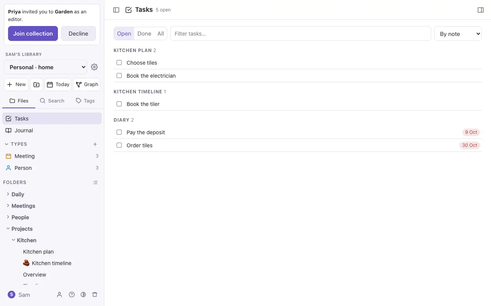

# Tasks and daily notes

## Tasks

Any line like `- [ ] Order seeds` is a task, in any note. Tick its box in Live Preview or Reading view to mark it done (`- [x]`).

Give a task a due date with a calendar emoji and a date: `- [ ] Pay the deposit 📅 2026-10-09`.

**Tasks** (at the top of the file panel) lists every task in the collection in one place:

- **Open** or **Done**.
- **By note**, or **By due date**: Overdue, Today, Later and No date.
- Tick a task there and it's ticked in its note.

## Reminders

The DO Notes app on your iPhone and Mac reminds you about dated tasks on the day. A task reminds you when it isn't ticked, has a date (`📅 2026-11-02`), and either sits in a note you wrote or last edited, or names you: `@David`, `@David Oliver` or `[[David Oliver]]`. In a collection shared with others, their own tasks remind them, not you.

- **The time:** 09:00 on the day, unless you change it in Settings → **Account** → **Reminders**. Give one task a time of its own with `⏰ 14:30` (or `⏰ 2026-11-01 18:00` to be reminded the day before).
- **From the alert:** **Done** ticks the task in its note; **Remind me in an hour** asks again later; tapping the alert opens the note.
- **When they update:** whenever you open the app, and on the iPhone now and then in the background too. The alerts are on the device, so they arrive offline.
- The first time there's a reminder, the app asks whether it may send notifications. If you said no, turn them on in Settings → **Notifications** → **DO Notes** on the iPhone, or System Settings → **Notifications** on the Mac. Switch reminders off altogether in Settings → **Account**.

## Daily notes

**Today** (at the top of the file panel) opens today's note, `Daily/2026-10-18.md`, and makes it if it isn't there yet. If there's a template called `Templates/Daily.md`, new daily notes start from it.

On a daily note the side panel shows a **calendar**: pick a day to open its note, and see what was made and changed in the collection that day.

> [!tip]
> A `TASK` query in a daily note can gather the tasks due that day; see [Queries and diagrams](queries.md).
