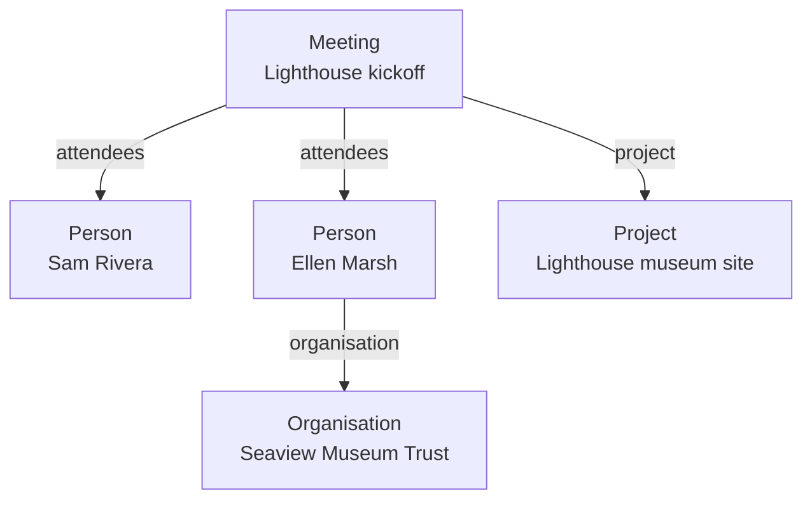
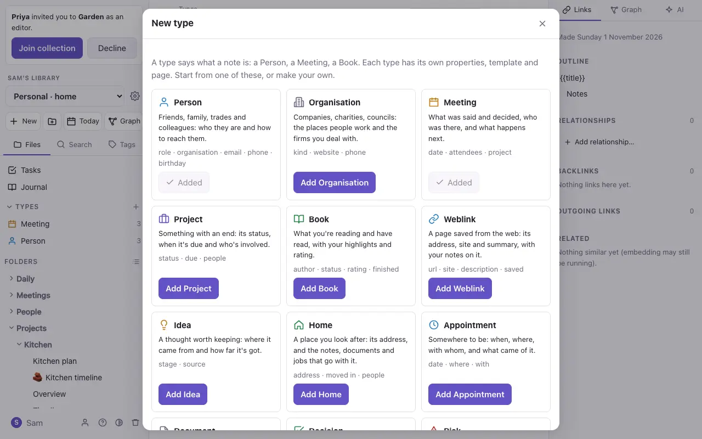
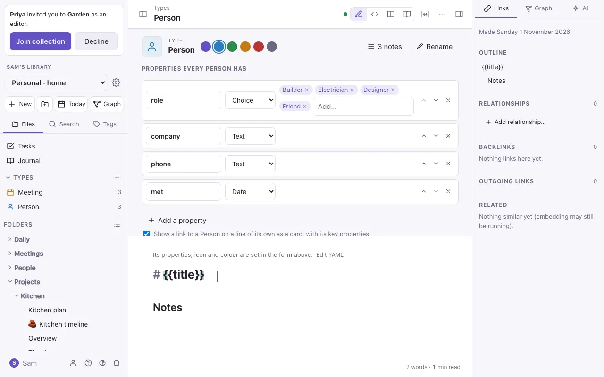
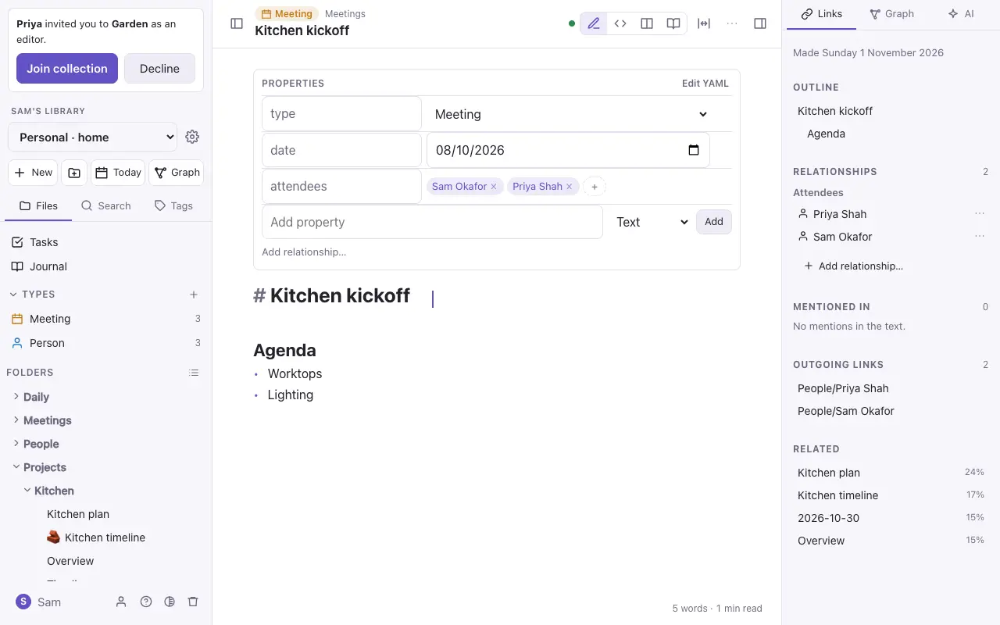
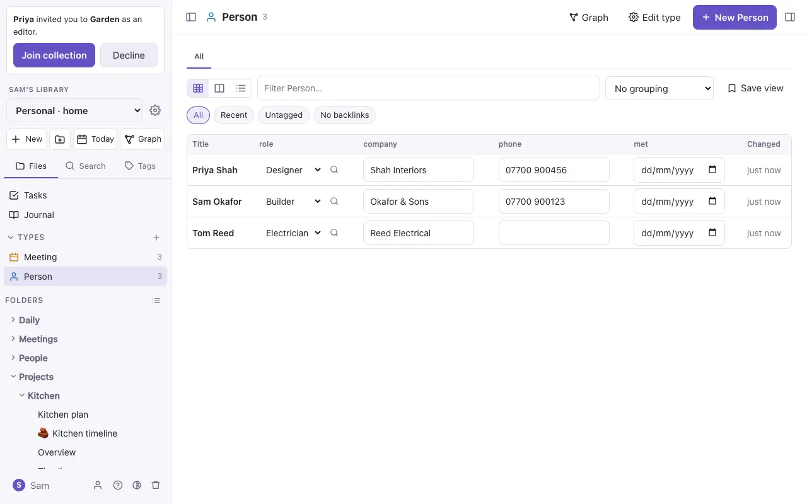

# Properties and types

## Properties

Properties are facts about a note, kept at the top of it in a block called *frontmatter*:

```yaml
---
status: Active
due: 2026-12-05
tags: [project, museum]
---
```

In Live Preview they show as a panel you edit in place: text, numbers, dates, tick boxes and lists. **Add property** adds one; **Edit YAML** shows the raw block. Properties can be read by [queries](queries.md) and shown on type pages (below).

You can also write a property inline, on a line of its own: `rain:: 12`.

## Types

A **type** says what a note *is*: a Person, a Meeting, a Book. Give a note `type: Person` and it gets that type's properties, icon and colour.



A type is itself a note, in the `Types` folder, such as `Types/Person.md`. Its properties list what every Person has, and its text is the template for a new Person.

- **New type** (the **+** beside *Types* in the file panel) starts from a ready-made type (Person, Organisation, Meeting, Project, Book, Weblink, Idea and more, including the architecture types for [notes from Floe](import-export.md)) or from nothing.
- **New note of a type…** (in `⌘K`) makes a note of a type, with its form ready to fill in.
- **Turn into a typed note…** makes a new typed note from the selected text, and links to it.
- **As you write:** type `#` and the start of a type's name, and choose **New Person…** (or whichever type) from the list beside the tags. Type the name, say `Sam Okafor`, and press Enter: the note is made from the type's template and `[[Sam Okafor]]` is left where you typed. If a note of that name exists already, it's linked instead. Undo puts back what you typed. A tag you type yourself, such as `#person`, stays a tag.



### Editing a type

Open a type's note to change its properties: text, number, date, tick box, list, a choice from a list, or a **relation** (a link to a note of another type, such as a Meeting's attendees). You can also set the icon and colour, and whether links to it show as cards. Renaming a property or the type changes it in every note.



### Relations

A relation is an ordinary link in a property: `attendees: ["[[Sam Rivera]]"]`. Both sides see it: Sam's note lists *As attendees: Lighthouse kickoff*.



### Ids

A note can have an `id`: a short name made from its title, such as `kitchen-extension`, that stays the same when the note is renamed or moved. `[[kitchen-extension]]` always finds it, and other collections and tools such as Longview use it to point at the note ([AI-XF bundles](import-export.md)).

A new note gets one when it's named. It's written into the note's properties but kept out of sight: the properties panel and reading view don't show it, and **Copy the note's id** in the note's ⋯ menu (or `⌘K`) copies it. Daily notes, type notes and boards don't get one, and a note that already says its own keeps it. Notes from before get theirs the first time the collection is exported as an AI-XF bundle. To stop new notes getting one, turn off **Give new notes an id** in Settings → This collection, under Export.

### Relationships between any notes

Any note, typed or not, can say how it relates to another: a page is *part of* a guide, a plan *depends on* a budget, a new policy *supersedes* an old one. Click **Add relationship…** under the properties (or press ⌘K, or type `/` in the note). The relationship builder reads as one sentence: **this note**, **how it's related**, **the other note**. Type in each box to filter its list, use the arrow keys and Enter to choose, and focus moves on to the next box; notes this one already links to come first. The sentence underneath says the whole relationship as it changes, and a screen reader reads it out. **Add** saves it, and **Undo** in the message takes it back.

Either way round works. From Loft you can choose *comes after* and Roof: it's written into Roof as *comes before Loft*, since a relationship always lives in the note it starts from. **Swap** reads the same relationship from the other note. To make a kind that isn't in the list, type its name and choose **New kind “…”**, then give its name the other way round.

It's written as a property named after the relationship, so it stays plain Markdown:

```yaml
part-of: "[[Onboarding]]"
depends-on:
  - "[[Payroll setup]]"
  - "[[IT accounts]]"
```

The other note shows it the other way round in the side panel: Onboarding lists this note under **Has part**. That's how to build a guide out of pages: each page says it's *part of* the guide, and the guide lists its parts, with no folders needed.

| Relationship | The other note shows |
| --- | --- |
| Part of, Has part | Has part, Part of |
| Depends on | Depended on by |
| References | Referenced by |
| Derived from | Source of |
| Supersedes, Superseded by | Superseded by, Supersedes |
| Supports | Supported by |
| Contradicts | Contradicts |
| Describes | Described by |
| Authored by | Author of |
| Relates to | Relates to |

These are the relationships of AI-XF, the format other knowledge tools read, so they keep their meaning when notes move between tools.

#### Your own kinds of relationship

To add your own, such as *comes before*, make a note called **Relationships** at the top of the collection, with a table of each one's name, its name the other way round, and what it means:

```markdown
| Relationship | Other direction | Meaning |
| --- | --- | --- |
| comes before | comes after | Happens first |
| twin of | — | Made twice; reads the same both ways |
```

They're offered first in the relationship builder, and the other note shows yours under the other direction's name: Loft lists Roof under *comes after*. A type's own relations (a Meeting's *attendees*) are offered too. The note travels with the collection's files, and an AI-XF export carries your kinds with both their names, so they come back on import.

#### A note's relationships, in the side panel

**Relationships** in the side panel lists every relationship a note has, both the ones it holds and the ones other notes hold about it, each in its own words from this note: on Loft, Roof is under *comes after*; on Roof, Loft is under *comes before*. Each kind's two directions sit together. Click a note to open it, or **Add relationship…** at the bottom to make one.

The **⋯** beside each one changes it, by mouse or keyboard (Tab to it, Enter, then the arrow keys):

- **Change…** opens the builder on it, to choose another kind or another note.
- **Swap** turns it round: *Loft comes after Roof* becomes *Loft comes before Roof*.
- **Reverse** keeps the same relationship but writes it into the other note, under the other direction's name: `comes-before: [[Loft]]` in Roof becomes `comes-after: [[Roof]]` in Loft. Use it when the relationship belongs with the other note. A type's own relations, which have no name the other way round, stay where they are.
- **Remove** takes it out.

Each says what it did, and **Undo** in that message puts both notes back as they were.

## Type pages

Each type has a page (click it under *Types* in the file panel) listing its notes as a **table**, **cards** or a **list**. Filter, sort and group them, and edit cells in place. Save a view to keep it; views are saved in a `.base` file beside the type, which other editors read too.



> [!tip]
> Types are plain Markdown. Exported, a Person is a note with `type: Person` at the top, and the type is a note in `Types/`.
