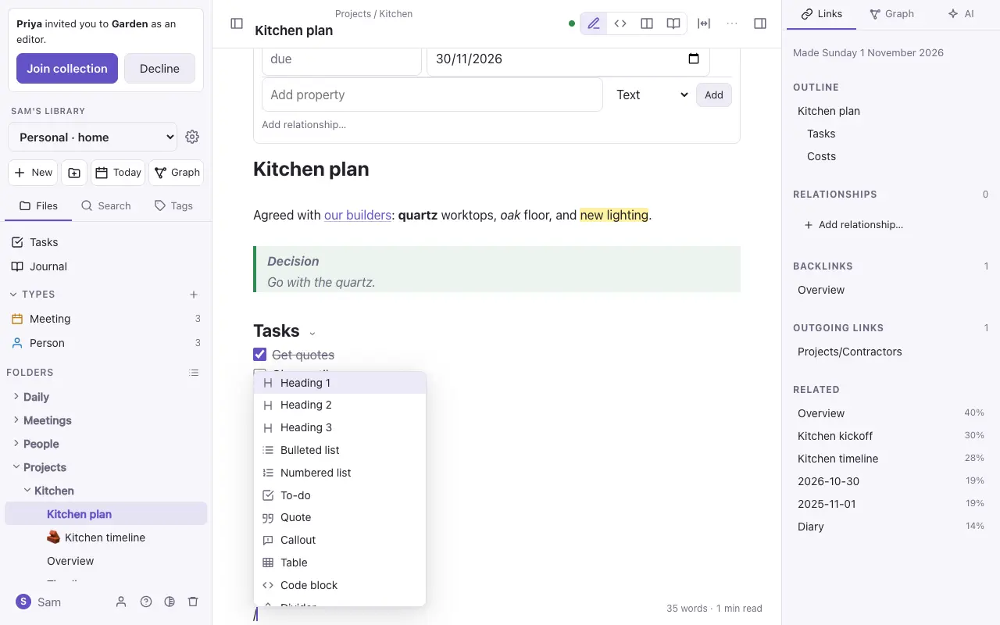
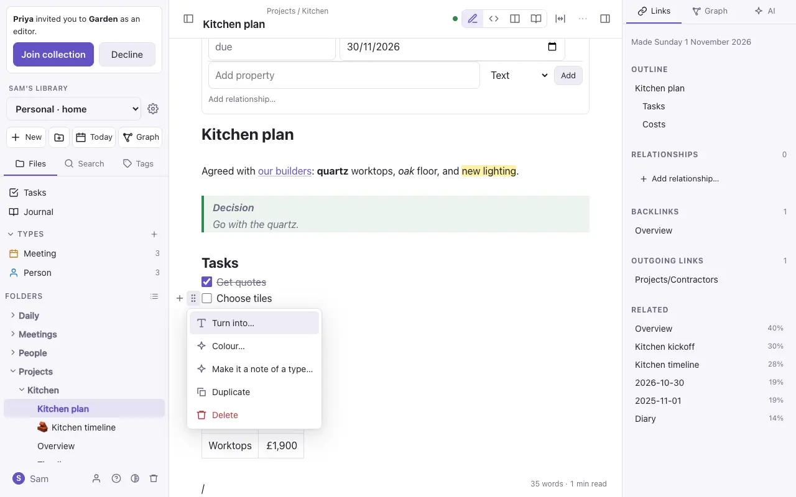
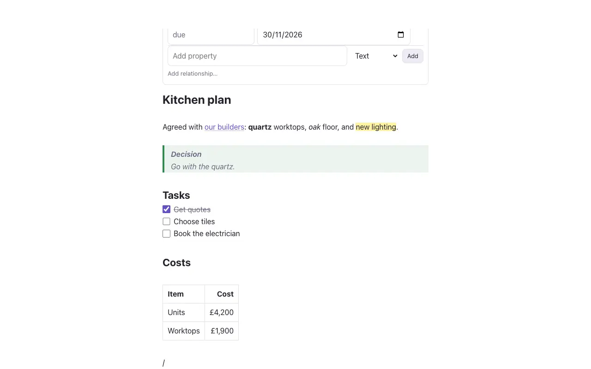
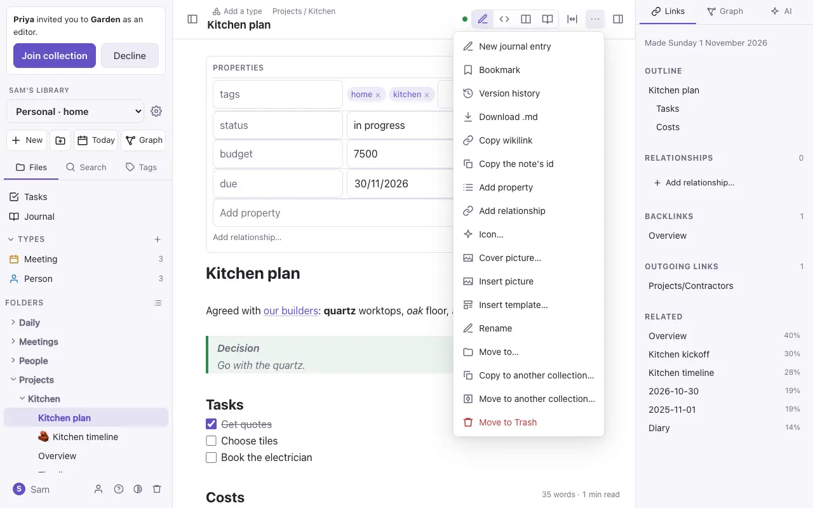

# Writing notes

Notes are Markdown. You don't need to know Markdown to start, because the `/` menu and the formatting bar write it for you, but everything you type is plain text you could edit anywhere.

## Four ways to see a note

The buttons at the top right of a note switch between them.

| View | What it shows |
| --- | --- |
| **Live Preview** (pencil) | The note formatted as you type. The line you're on shows its Markdown, so you can still edit it. |
| **Source** (`</>`) | The plain Markdown, with colour. |
| **Side by side** | Source on the left and the finished page on the right. Laptops only. |
| **Reading** (book) | The finished page, read-only. Tick tasks and follow links. |

## Formatting

Select some words and a bar appears above them (on a laptop): a heading, **bold**, *italic*, ~~strikethrough~~, ==highlight==, `code`, a link and colour. Each button takes the formatting off again if it's already there, as do `⌘B`, `⌘I`, `⌘⇧X` and `⌘E`. **Link** asks for a note, or a web address, and keeps your words as the link's text. On the iPhone, use the bar above the keyboard. (The bar and these keys aren't in the standalone file.)

| Type this | To get |
| --- | --- |
| `# Heading`, `## Smaller` | Headings |
| `**bold**`, `*italic*`, `~~struck~~` | **bold**, *italic*, ~~struck~~ |
| `==highlight==` | ==highlight== |
| `- item` or `1. item` | Lists |
| `- [ ] task` | A task with a tick box |
| `> quote` | A quote |
| `> [!tip] Title` | A callout (also `note`, `info`, `warning`, `example` and others) |
| `> [!note]- Title` | A callout that opens and closes, closed to start (`+` instead of `-`: open to start) |
| `:status[On track]{.green}` | A coloured status label (also `.blue`, `.amber`, `.red`, `.purple`; none is grey) |
| `[TOC]` on a line of its own | A table of contents: the note's headings, each a link |
| `//` | Pick a date (today, tomorrow, the coming week, or any day), written as `2026-10-26` |
| `:rocket` | An emoji: type `:` and part of its name, then choose |
| A web address on a line of its own | A card with the page's title, summary and picture |
| `` `code` `` and ```` ``` ```` | Code |
| `---` | A dividing line |
| `[[Note]]` | A link to a note; see [Links and embeds](links.md) |
| `#tag` | A tag |

Click a closed callout's **›** to open it. Opening and closing it only changes what you see, not the note; in Reading view and on a published site it opens with a click too.

`/status` asks for the label's words and colour, `/date` opens a date picker, and `/table of contents` adds `[TOC]`. Other Markdown editors show these as the text you see in the table above, so nothing is lost.

`⌘⇧H` colours the selected text, or highlights it, from a palette. The colour is saved as a small piece of HTML that other editors show too.

## Icon, cover and width

From the note's **⋯** menu or `⌘K`:

- **Icon…** puts an emoji beside the note's title, here and in the file list.
- **Cover picture…** shows a picture across the top of the note: upload one, or use one on the web.
- **Wide page** gives the note more room, for wide tables and diagrams; **Normal page width** puts it back.

Each is a property at the top of the note (`icon: 🚀`, `cover: "[[attachments/harbour.jpg]]"`, `width: wide`), so you can also set them there.

## The / menu

At the start of a line, type `/` for a list of blocks: headings, lists, a to-do, a quote, a callout, a table, code, a divider, a picture, today's date, a template and more. Keep typing to narrow it down, then press Enter.



## Moving and changing blocks

Hover over a paragraph, heading or list item (or put the cursor in it on a phone) and two handles appear beside it:

- **+** adds a block below.
- **⋮⋮** opens a menu to turn the block into another kind, colour it, duplicate it or delete it. Drag **⋮⋮** to move the block, with its sub-items, somewhere else.



## Tables

In Live Preview a table is a grid you edit cell by cell. **Tab** goes to the next cell and **Shift-Tab** to the one before; **Tab** in the last cell adds a row. Click a cell and a bar appears above the table:

- **Row:** insert a row above or below, move it up or down, or delete it.
- **Column:** insert a column left or right, move it, delete it, or **sort** the rows by it, A to Z or Z to A. Amounts sort as numbers, so £1,200 comes after 90; empty cells go last.
- **⇤ ↔ ⇥** align the column, and **Markdown** shows the table's text.

To bring in a table from a spreadsheet, copy the cells in Numbers, Excel or Google Sheets and paste them into the note: they become a table, with the first row as its header. Pasted into a cell of a table that's already there, they fill the cells from that one across and down, adding rows and columns if they need to.

In Markdown it's saved with the pipes lined up:

```
| Bed | 2026         |
| --- | ------------ |
| 1   | Runner beans |
```

> [!warning] A link with a label inside a table
> Write `[[Note\|label]]`, with a backslash before the `|`. Otherwise the `|` starts a new column.

## Pictures and files

Paste or drop a picture into a note to upload it. It's saved in the `attachments` folder and shown with `![[attachments/photo.png]]`. A pasted picture, which has no name of its own, is named after the note: `Kitchen plan.png`, then `Kitchen plan 1.png`. To size it, add a width: `![[photo.png|300]]`. Click a picture to see it on its own, as large as fits; click again or press Escape to close it. Audio, video and PDFs work the same way. On a phone, use the picture button above the keyboard to pick from Photos or take a photo.

## Folding

Rest the pointer on a heading, or on a list item with others under it, and a **›** appears after it: click it to fold away everything under it, up to the next heading of the same size. The folded part shows as **⋯ 12 lines**; click that (or the arrow) to open it again. `⌘K` has **Fold all headings**, which leaves just the outline, and **Unfold all**. Folding only changes what you see: the note isn't changed, and other people see it as they left it. On the iPhone, the arrow shows on the line you're on. (Live Preview and Source; not in the standalone file.)

## Code

Put code between ```` ``` ```` lines, with its language after the first: ```` ```python ````. JavaScript, TypeScript, Python, SQL, JSON, YAML, HTML, CSS and shell are coloured, in the note, in Reading view and on published pages. In Live Preview, the code block's language at the top right is a button: click it to choose another. **Copy** copies the code.

## Words and where you were

At the bottom right of a note (on a laptop): how many words it has and how long it takes to read, or, with text selected, how many words you've selected. The properties at the top don't count.

A note reopens where you left it, with the cursor and the scroll as they were, on the same device. (Neither is in the standalone file.)

## Templates

A note in the `Templates` folder is a template. **New note from template** (in `⌘K`) makes a note from one, and **Insert template** adds one to the note you're in. `{{title}}`, `{{date}}` and `{{time}}` are filled in.

## Spelling and grammar

Your browser's spell check, the iPhone keyboard's autocorrect, capitals and suggestions, and Grammarly (its browser extension or its keyboard) can all help as you write. Code, the properties at the top of a note, inline `code` and links are left alone, so nothing "corrects" them. To turn the help off on this device, use `⌘K` → **Turn off spelling and grammar help**, or Settings → **Account** → **Writing**.

## Full-width editor

To give every note the whole window, click the **↔** button beside the view switch at the top of a note, or use `⌘K` → **Full-width editor**. The text then fills the space between the file list and the side panel, and grows or shrinks as you open, close or drag them. Click it again (or `⌘K` → **Normal editor width**) to go back to the reading width. It's kept on this device, and is also in Settings → **Account** → **Appearance**. To widen only one note, use **Wide page** instead.

## Focus mode

**Focus mode** (in `⌘K`, and in the **⋯** menu on the iPhone) hides everything except the text. Press Escape, or tap **Leave focus** on the iPhone, to leave it.



## The note's ⋯ menu

The **⋯** menu at the top of a note has what you can do with it: bookmark it, see its version history, download it as `.md`, copy a link to it, add a property, insert a picture or template, rename it, move it, or move it to Trash.


